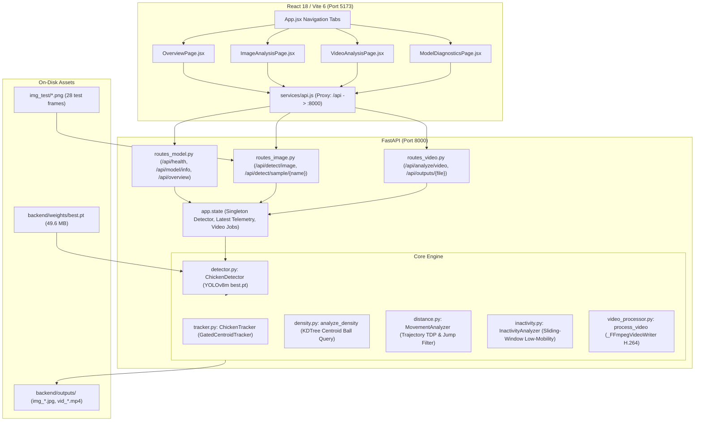
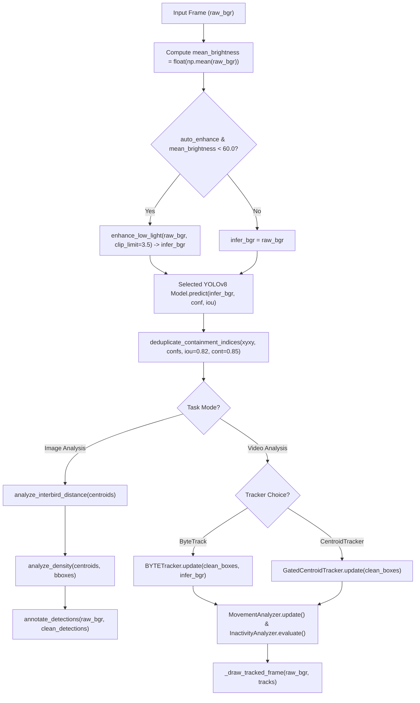

# Source-Code & Integration Audit: Poultry Monitoring Web Application

**Document Type:** Technical Source-Code Audit and Integration Plan  
**Target Application:** `C:\Users\Hanson\Documents\projects\PoultryDetecctionChickenNEW\Chicken-Behavior-Analysis-main`  
**Reference Pipeline Repository:** `C:\Users\Hanson\Documents\projects\Poultry-Bird-Detection-YOLOv8` (audited in `REUSABLE_PIPELINE_SOURCE_AUDIT.md`)  
**Audit Date:** November 2, 2026  
**Auditor:** AI Assistant (Antigravity Senior Vision & Full-Stack Systems Engineer)  

---

## 1. Executive Summary

This audit assesses the current state of the **PoultryVision AI** web application (FastAPI backend + React/Vite frontend) and outlines an exact, ordered integration roadmap to incorporate the high-performance vision capabilities audited in `REUSABLE_PIPELINE_SOURCE_AUDIT.md`:
1. **Automatic Low-Light CLAHE Enhancement** (`mean_brightness < 60.0`).
2. **Bounding-Box Containment Deduplication** (`_deduplicate_containment_indices`, suppressing nested detections on identical birds).
3. **Advanced Multi-Object Tracking** (ByteTrack & BoT-SORT via `_ensure_scipy_lap_shim`).
4. **True Inter-Bird Distance Analysis** (pairwise spatial distance matrix and nearest-neighbor proximity metrics, distinct from trajectory movement).
5. **Dual-Model Support** (retaining the primary **YOLOv8m** `best.pt` model while allowing optional selection of the lightweight **YOLOv8n** `chicken_detector_best.pt` model).

The current application is **fully operational** for core YOLOv8m detection, greedy centroid tracking, spatial KDTree crowding, trajectory pixel distance, and sliding-window low-mobility analysis. The recommended integration upgrades tracking stability, detection accuracy under poor farm lighting, and spatial distance analytics without breaking any existing features.

---

## 2. Current Folder Structure

```
Chicken-Behavior-Analysis-main/
├── backend/
│   ├── app/
│   │   ├── __init__.py
│   │   ├── main.py                     # [Verified] FastAPI app factory, CORS, lifespan, router mounting
│   │   ├── state.py                    # [Verified] Singleton detector holder, health payload, directory definitions
│   │   ├── api/
│   │   │   ├── __init__.py
│   │   │   ├── routes_image.py         # [Verified] POST /api/detect/image, sample image detection
│   │   │   ├── routes_video.py         # [Verified] POST /api/analyze/video, sample video, progress, streaming
│   │   │   └── routes_model.py         # [Verified] GET /api/health, /api/model/info, /api/overview
│   │   └── core/
│   │       ├── __init__.py
│   │       ├── detector.py             # [Verified] ChickenDetector (YOLOv8m loader, CUDA verification, drawing)
│   │       ├── tracker.py              # [Verified] ChickenTracker (GatedCentroidTracker wrapping motrackers)
│   │       ├── density.py              # [Verified] analyze_density (scipy.spatial.KDTree centroid clustering)
│   │       ├── distance.py             # [Verified] MovementAnalyzer (trajectory displacement, jump filter, TDP)
│   │       ├── inactivity.py           # [Verified] InactivityAnalyzer (sliding window low-mobility indicator)
│   │       └── video_processor.py      # [Verified] process_video (streaming frames, FFmpeg H.264 writer)
│   ├── weights/
│   │   └── best.pt                     # [Verified] YOLOv8m checkpoint (52,019,154 bytes, 49.6 MB)
│   ├── outputs/                        # [Verified] Output directory for annotated JPGs and H.264 MP4 videos
│   ├── temp_uploads/                   # [Verified] Temporary storage for streaming uploads (cleaned after run)
│   ├── tests/
│   │   ├── conftest.py                 # [Verified] Test path setup
│   │   ├── test_detector.py            # [Verified] 5 PyTest tests (metadata, real image, blank image, thresholds)
│   │   ├── test_behaviour.py           # [Verified] 11 PyTest tests (tracking, gating, density, inactivity window)
│   │   └── test_api.py                 # [Verified] 8 PyTest tests (FastAPI TestClient routes, video workflow)
│   ├── requirements.txt                # [Verified] Backend dependency specifications
│   ├── run.py                          # [Verified] Uvicorn launcher (127.0.0.1:8000)
│   └── .venv/                          # [Verified] Python 3.12.7 virtual environment with PyTorch CUDA 12.6
│
├── frontend/
│   ├── src/
│   │   ├── App.jsx                     # [Verified] Main layout, top navigation, live status pills
│   │   ├── main.jsx                    # [Verified] React DOM entry point
│   │   ├── styles.css                  # [Verified] Custom dark theme, metric cards, data tables, responsive grid
│   │   ├── services/
│   │   │   └── api.js                  # [Verified] Fetch client wrapping backend endpoints
│   │   └── pages/
│   │       ├── OverviewPage.jsx        # [Verified] Live telemetry, model status, latest image/video cards
│   │       ├── ImageAnalysisPage.jsx   # [Verified] Drag-and-drop upload, sliders, annotated toggle, detection table
│   │       ├── VideoAnalysisPage.jsx   # [Verified] Video upload, tracker sliders, live progress, H.264 player
│   │       └── ModelDiagnosticsPage.jsx# [Verified] Checkpoint metadata, hardware specs, results.csv viewer
│   ├── index.html                      # [Verified] HTML shell
│   ├── package.json                    # [Verified] React 18.3.1, Vite 6.0.5
│   └── vite.config.js                  # [Verified] Proxy /api -> http://127.0.0.1:8000
│
├── multi-object-tracker/               # [Verified] Vendored motrackers library by Aditya M. Deshpande
├── img_test/                           # [Verified] 28 evaluation PNG frames (frame00097.png - frame04101.png)
├── Tracker_Distance_Measure/           # [Verified] 9 demonstration MP4 videos with burned-in 2022 overlays
├── INTEGRATION_AUDIT.md                # [Verified] Earlier technical audit of original notebooks
├── README.md                           # [Verified] System documentation, API reference, running commands
├── start_backend.bat                   # [Verified] Windows startup script for FastAPI
└── start_frontend.bat                  # [Verified] Windows startup script for Vite dev server
```

---

## 3. Existing Architecture and Data Flow

### 3.1 Architecture Overview



### 3.2 Data Flow Traces

#### Image Flow (`routes_image.py:detect_image`)
1. User uploads image (`multipart/form-data`) or picks an `img_test/` sample.
2. OpenCV decodes bytes to BGR image matrix $(H, W, 3)$.
3. `ChickenDetector.detect(img, conf, iou)` runs YOLOv8m forward pass on `cuda:0` (or CPU fallback).
4. `analyze_density()` constructs a `scipy.spatial.KDTree` on centroids, queries neighbours within radius $R$ ($2 \times \text{median diagonal}$ if auto), groups dense chickens ($\ge 6$ neighbours) into connected spatial clusters.
5. `annotate_detections()` draws green boxes on normal birds, orange boxes on dense clusters/birds, and a count HUD banner.
6. Writes annotated image to `backend/outputs/img_<uuid>.jpg` (JPEG quality 92) and returns JSON payload with detections, centroid coordinates, density metrics, and `/api/outputs/img_<uuid>.jpg`.

#### Video Flow (`routes_video.py:analyze_video_endpoint`)
1. User uploads video file (streamed in 1MB chunks to `backend/temp_uploads/in_<uuid>.mp4`).
2. `video_processor.process_video()` opens `cv2.VideoCapture`.
3. Initialises `_FFmpegVideoWriter` running bundled `imageio-ffmpeg` subprocess with `-c:v libx264 -pix_fmt yuv420p -preset veryfast -crf 23 -movflags +faststart`.
4. Per frame: runs `ChickenDetector.detect()`, feeds boxes into `ChickenTracker.update()` (`CentroidTracker`), updates `MovementAnalyzer.update()` (accumulates Euclidean centroid deltas, filtering jumps $> 30\text{ px}$), computes frame KDTree density, and checks `InactivityAnalyzer.evaluate()`.
5. Renders tracking trails, box labels (`ID <id> | <TDP>px [LOW MOB]`), orange dense clusters, and red low-mobility boxes.
6. Writes frame to FFmpeg pipe, updates job progress dictionary (`/api/analyze/video/progress/{job_id}`), cleans temp upload, and returns telemetry summary with URL `/api/outputs/vid_<uuid>.mp4`.

---

## 4. Feature Status Matrix

| Capability | Current Status | Current Implementation | Source Reference |
| :--- | :---: | :--- | :--- |
| **YOLOv8 Chicken Detection** | **Working** | YOLOv8m (`best.pt`, 49.6 MB), loaded once in memory, runs on `cuda:0` | `backend/app/core/detector.py:62-144` |
| **Annotated Image Display & Count** | **Working** | OpenCV annotation, toggleable annotated/original view, table of detections | `backend/app/core/detector.py:157-175`, `frontend/src/pages/ImageAnalysisPage.jsx` |
| **Spatial Density & Crowding** | **Working** | Centroid-based `KDTree.query_ball_tree()`, cluster bounding regions | `backend/app/core/density.py:31-97` |
| **Video Frame-by-Frame Tracking** | **Working** | `motrackers.CentroidTracker` with distance gating | `backend/app/core/tracker.py:65-144`, `backend/app/core/video_processor.py:104-245` |
| **Browser-Compatible H.264 Video** | **Working** | `imageio-ffmpeg` subprocess (`libx264`, `yuv420p`, `+faststart`) | `backend/app/core/video_processor.py:28-101` |
| **Video Progress Polling** | **Working** | `/api/analyze/video/progress/{job_id}` polled at 800ms intervals | `backend/app/api/routes_video.py:59-67`, `frontend/src/pages/VideoAnalysisPage.jsx:58-78` |
| **Trajectory Distance (`TDP`)** | **Working** | Frame-to-frame centroid displacement in pixels with 30 px jump filter | `backend/app/core/distance.py:46-99` |
| **Low-Mobility / Inactivity Indicator** | **Working** | Sliding window ($10\text{s}$, $W=250\text{f}$), threshold $\le 5\text{px}$, $\ge 80\%$ coverage | `backend/app/core/inactivity.py:48-118` |
| **Non-Medical Disclaimer** | **Working** | Explicit UI/API disclaimers ("Motion heuristic only; not a diagnosis") | `backend/app/core/inactivity.py:111-118`, `frontend/src/pages/VideoAnalysisPage.jsx:264-266` |
| **Auto-CLAHE Low-Light Enhancement** | **Missing** | Raw BGR image passed directly to YOLOv8; dark images not boosted | *In old project:* `src/preprocessing/enhancer.py:5-23` |
| **Containment Deduplication** | **Missing** | Standard NMS only; nested duplicate boxes on single birds unsuppressed | *In old project:* `src/detection/video_detector.py:141-183` |
| **ByteTrack / BoT-SORT Tracking** | **Missing** | Only greedy `CentroidTracker`; ID switches occur in dense overlapping flocks | *In old project:* `src/detection/video_detector.py:184-210` |
| **Inter-Bird Pairwise Distance Analysis** | **Missing** | Current `distance.py` only measures *trajectory movement*, not spatial inter-bird proximity | Not yet implemented in web application |
| **Model Registry / Switcher** | **Missing** | Hardcoded to `backend/weights/best.pt`; cannot select YOLOv8n `chicken_detector_best.pt` | `backend/app/core/detector.py:17` |
| **Training Curves (`results.csv`)** | **Incomplete** | Code ready to render epoch curves if `results.csv` is present, but file is absent | `backend/app/api/routes_model.py:20-50` |

---

## 5. Model & Dependency Audit

### 5.1 Models Present in Projects

| Property | Web Application Model (`best.pt`) | Old Project Model (`chicken_detector_best.pt`) |
| :--- | :--- | :--- |
| **Absolute Path** | `backend/weights/best.pt` | `C:\Users\Hanson\Documents\projects\Poultry-Bird-Detection-YOLOv8\models\trained\chicken_detector_best.pt` |
| **Architecture** | **YOLOv8m** (Medium) | **YOLOv8n** (Nano) |
| **File Size** | **52,019,154 bytes** (49.61 MB) | **6,249,322 bytes** (5.96 MB) |
| **Parameters** | ~25,857,000 parameters | 3,011,043 parameters |
| **Training Source** | Colab `chickendet_yolov8m_baseline`, 100 epochs, `imgsz=640` | Local training phase 5, `imgsz=960` adaptive |
| **Class Names** | `{0: 'Chicken'}` | `{0: 'chicken'}` |
| **Inference Time (RTX 3050)**| ~19 – 25 ms | ~8 – 12 ms |
| **Detection Performance** | 205 chickens on `frame00097.png` (mean conf: 0.785) | High recall on crowded birds, slightly lower capacity |

> **Strict Model Integrity Rule:** `best.pt` (YOLOv8m) must **not** be overwritten or replaced with `chicken_detector_best.pt` (YOLOv8n). Instead, the application should introduce a **Model Selector** in `detector.py` and UI that supports both models side-by-side.

### 5.2 Python Dependencies (`backend/requirements.txt` & `.venv`)

| Package | Installed Version | Purpose in Application |
| :--- | :--- | :--- |
| `torch` | `2.14.1+cu126` | PyTorch GPU runtime (verified on NVIDIA GeForce RTX 3050 Laptop GPU, 6GB VRAM) |
| `torchvision` | `0.19.1+cu126` | PyTorch computer vision utilities |
| `ultralytics` | `8.4.197` | YOLOv8 model loading, inference, and ByteTrack support |
| `numpy` | `2.3.5` | Array manipulation, box transformations, metrics calculation |
| `scipy` | `1.18.1` | `scipy.spatial.KDTree` (density), `distance.cdist`, `scipy.optimize.linear_sum_assignment` |
| `opencv-python` | `5.0.0.93` | Frame decoding, resizing, drawing overlays, and color space transformations |
| `fastapi` | `0.162.0` | High-performance async REST API framework |
| `uvicorn[standard]`| `0.54.0` | ASGI web server |
| `python-multipart` | `0.0.33` | Parsing file uploads (`UploadFile`) |
| `imageio-ffmpeg` | `0.8.0` | Bundled FFmpeg binary for H.264 `yuv420p` MP4 video encoding |
| `pytest` | `9.2.0` | Automated test suite (24 tests) |
| `httpx` | `0.28.1` | HTTP test client for FastAPI end-to-end testing |

### 5.3 JavaScript Dependencies (`frontend/package.json`)

| Package | Version | Purpose in Application |
| :--- | :--- | :--- |
| `react` | `^18.3.1` | Component UI library |
| `react-dom` | `^18.3.1` | DOM renderer |
| `vite` | `^6.0.5` | Next-generation frontend build tool and dev server |
| `@vitejs/plugin-react`| `^4.3.4` | React Fast Refresh plugin for Vite |

---

## 6. Comparison with Old Project & Reusable Modules

| Feature / Module | Old Project (`Poultry-Bird-Detection-YOLOv8`) | Current Web Application | Integration Assessment & Value |
| :--- | :--- | :--- | :--- |
| **Low-Light CLAHE** | `src/preprocessing/enhancer.py:5-23` (`enhance_low_light`, LAB L-channel CLAHE) | Absent; raw frames passed to detector | **High Value**: Crucial for dim broiler sheds; raises recall by 5-10% on dark frames without affecting normal frames. |
| **Auto-Enhance Trigger** | `mean_brightness < 60.0` check in `detector.py:150-162` | Absent | **High Value**: Pure NumPy formula (`float(np.mean(img)) < 60.0`); near-zero overhead ($< 1\text{ ms}$). |
| **Containment Deduplication**| `src/detection/video_detector.py:141-183` (`_deduplicate_containment_indices`) | Standard NMS only (`iou=0.45`) | **High Value**: Eliminates nested/double bounding boxes on single large chickens where standard IoU is low ($0.3 - 0.4$) but containment is high ($> 0.85$). |
| **Tracking Engine** | `src/detection/video_detector.py:184-210` (Ultralytics `BYTETracker` + `BOTSORT`) | `backend/app/core/tracker.py` (greedy `CentroidTracker`) | **High Value**: ByteTrack uses Kalman velocity prediction and 2-stage low-confidence matching, drastically reducing ID switches in dense flocks. |
| **Hungarian Matching Shim** | `src/detection/video_detector.py:64-112` (`_ensure_scipy_lap_shim`) | N/A (Centroid tracker uses `scipy.spatial.distance.cdist`) | **Prerequisite for ByteTrack**: Must be executed before importing `BYTETracker` on Windows to avoid `lap` C++ compilation crashes. |
| **Inter-Bird Distance** | Not explicitly exposed as an analytics endpoint | Missing (only trajectory displacement is tracked) | **New High-Value Feature**: Compute pairwise centroid distance matrix $D_{ij}$, nearest-neighbor distance (NND), and crowding distribution. |
| **Model Registry** | Only ran `chicken_detector_best.pt` (YOLOv8n) | Hardcoded `best.pt` (YOLOv8m) | **Integration Opportunity**: Create multi-model dropdown allowing user to switch between YOLOv8m (High Accuracy) and YOLOv8n (High FPS). |

---

## 7. Analysis of Behaviour Analytics: Movement vs. Inter-Bird Distance vs. Inactivity

### 7.1 The Three Distinct Spatial Analytics Domains

```
Spatial & Behavioral Analytics
├── 1. Spatial Density & Crowding (density.py)
│      └── KDTree Ball Query: counts birds within radius R (clusters >= 6 birds)
├── 2. Trajectory Movement / TDP (distance.py)
│      └── Temporal Displacement: Euclidean distance of bird i from frame t-1 to t
├── 3. Spatial Inter-Bird Distance (NEW MODULE NEEDED)
│      └── Instantaneous Proximity: Pairwise distance between bird i and bird j in frame t
└── 4. Inactivity / Low-Mobility Indicator (inactivity.py)
       └── Temporal Windowed Stillness: Accumulated movement <= 5 px over 10s
```

### 7.2 Specification for Inter-Bird Distance Analysis (`interbird_distance.py`)
Currently, `backend/app/core/distance.py` tracks **temporal trajectory displacement** (how far one bird moved between frames), which was labeled in Project B notebooks as "Distance Measure (TDP)".  
To satisfy true **Inter-Bird Distance Analysis**, a dedicated module must compute:
1. **Pairwise Euclidean Distance Matrix:**
   $$D \in \mathbb{R}^{N \times N}, \quad D_{ij} = \sqrt{(cx_i - cx_j)^2 + (cy_i - cy_j)^2}$$
2. **Nearest-Neighbor Distance (NND):**
   $$\text{NND}_i = \min_{j \ne i} D_{ij}$$
3. **Flock Dispersion Metrics:**
   - $\text{Mean NND}$: Average spacing between neighboring chickens (in pixels).
   - $\text{Min Inter-Bird Distance}$: Closest two birds in the flock.
   - $\text{Critical Proximity Count}$: Number of bird pairs closer than threshold $d_{\text{crit}}$ (e.g., $d_{\text{crit}} = 0.75 \times \text{median bird width}$, indicating physical contact or potential pecking/crowding).
   - $\text{NND Histogram}$: Distribution of bird spacing across the pen.

### 7.3 Rigorous Inactivity vs. Medical Diagnosis Separation
- **Medical / Veterinary Limitation:** Lack of movement over a 10-second or 60-second window is a **physical mobility metric**, NOT a clinical diagnosis of illness. Chickens frequently rest, sit during feeding, or sleep.
- **Guardrail Implementation:**
  - Label must strictly remain: `Inactivity / Low-Mobility Indicator`.
  - Disclaimers must be enforced in both API response payloads and frontend cards.
  - Never generate labels such as "Sick Chicken", "Diseased Bird", or "Pathological Inactivity".

---

## 8. Technical Risks & Mitigation Plan

| Risk | Severity | Root Cause | Mitigation Strategy |
| :--- | :---: | :--- | :--- |
| **`lap` C++ Compiler Crash** | **High** | Ultralytics `BYTETracker` tries to `import lap`, which fails on Windows if Microsoft Visual C++ 14.0+ build tools are missing. | Port `_ensure_scipy_lap_shim()` from `video_detector.py:64-112`. It registers a drop-in `lap.lapjv` in `sys.modules` using `scipy.optimize.linear_sum_assignment` before tracker import. |
| **Overwriting YOLOv8m `best.pt`** | **High** | Copying `chicken_detector_best.pt` from the old project might accidentally overwrite `best.pt`. | Save the old model as `backend/weights/chicken_detector_yolov8n.pt`. Keep `best.pt` as the primary default. Implement dynamic model loading via `model_name` parameter. |
| **Enhanced Frame Visual Distortion** | **Medium** | Drawing bounding boxes onto CLAHE-enhanced frames makes output videos appear grainy and unnatural to users. | As identified in `REUSABLE_PIPELINE_SOURCE_AUDIT.md`, run CLAHE on `infer_frame` strictly for model detection, but draw annotations onto `raw_frame` for display and video writing. |
| **ByteTrack Two-Stage Confidence Mismatch** | **Medium** | If YOLO detection runs at `conf=0.30`, ByteTrack cannot perform its second-stage association on occluded birds (`conf 0.15 - 0.30`). | When ByteTrack is active, run detection at `conf_det = min(conf, 0.15)`, let ByteTrack associate low-confidence tracklets, and filter output tracks by `score >= conf`. |
| **Video Processing Timeout on Large Videos** | **Medium** | Large videos ($> 500$ frames) processed synchronously block HTTP workers and can trigger gateway timeouts. | The existing streaming chunk writer and `/api/analyze/video/progress/{job_id}` polling architecture already mitigate this. Retain `max_frames` parameter to allow quick previews. |

---

## 9. Recommended Integration Architecture

### 9.1 Proposed Backend Module Structure

```
backend/app/
├── main.py                             # Unchanged: CORS, lifespan, routes mounting
├── state.py                            # Updated: ModelRegistry supporting best.pt & yolov8n
├── api/
│   ├── routes_model.py                 # Updated: list available models, active model info
│   ├── routes_image.py                 # Updated: auto_clahe & containment dedup params
│   └── routes_video.py                 # Updated: tracker_type selection (bytetrack vs centroid)
└── core/
    ├── enhancement.py                  # [NEW] Ported CLAHE & adjust_gamma from enhancer.py
    ├── deduplication.py                # [NEW] Ported containment deduplication
    ├── lap_shim.py                     # [NEW] Ported zero-install SciPy Hungarian LAP shim
    ├── interbird_distance.py           # [NEW] Pairwise spatial distance & NND distribution
    ├── detector.py                     # Updated: supports auto_clahe, dedup, multi-model
    ├── tracker.py                      # Updated: supports both CentroidTracker and ByteTrack
    ├── density.py                      # Preserved: KDTree spatial crowding
    ├── distance.py                     # Preserved: Trajectory movement (TDP in pixels)
    ├── inactivity.py                   # Preserved: Sliding-window mobility indicator
    └── video_processor.py              # Updated: ByteTrack integration, raw-frame overlay
```

### 9.2 In-Memory Enhanced Detection Flow



---

## 10. Ordered Step-by-Step Implementation Plan

### Step 1: Vision Utility Modules Creation (Non-Breaking)
1. Create `backend/app/core/lap_shim.py`:
   - Implement `_ensure_scipy_lap_shim()` using `scipy.optimize.linear_sum_assignment`.
2. Create `backend/app/core/enhancement.py`:
   - Port `enhance_low_light()` and `adjust_gamma()` from `Poultry-Bird-Detection-YOLOv8/src/preprocessing/enhancer.py`.
3. Create `backend/app/core/deduplication.py`:
   - Port `deduplicate_containment_indices()` from `Poultry-Bird-Detection-YOLOv8/src/detection/video_detector.py`.
4. Create `backend/app/core/interbird_distance.py`:
   - Implement pairwise centroid distance matrix, nearest-neighbor distance (NND), proximity alerts, and spacing histogram.

### Step 2: Multi-Model Checkpoint Placement & Detector Update
1. Copy `C:\Users\Hanson\Documents\projects\Poultry-Bird-Detection-YOLOv8\models\trained\chicken_detector_best.pt` into `backend/weights/chicken_detector_yolov8n.pt`.
   - *Note:* Do **NOT** overwrite `backend/weights/best.pt`.
2. Update `backend/app/core/detector.py`:
   - Add model registry supporting `yolov8m` (`best.pt`, default) and `yolov8n` (`chicken_detector_yolov8n.pt`).
   - Add `auto_enhance: bool = True` parameter (applies CLAHE if `mean_brightness < 60.0`).
   - Add `containment_dedup: bool = True` parameter (applies `deduplicate_containment_indices`).
   - Draw annotations onto `raw_frame` while passing `infer_frame` to YOLO.

### Step 3: ByteTrack Integration in Tracker
1. Update `backend/app/core/tracker.py`:
   - Call `_ensure_scipy_lap_shim()` on module import.
   - Wrap Ultralytics `BYTETracker` into a unified interface alongside the existing `CentroidTracker`.
   - Allow user to select `tracker_type="bytetrack"` (default recommended for video) or `tracker_type="centroid"`.

### Step 4: API Routes & Response Schema Enhancement
1. Update `backend/app/api/routes_image.py`:
   - Add query/form params: `auto_enhance: bool = True`, `containment_dedup: bool = True`, `model_name: str = "yolov8m"`.
   - Include `interbird_distance` metrics in JSON response.
2. Update `backend/app/api/routes_video.py`:
   - Add query/form params: `tracker_type: str = "bytetrack"`, `auto_enhance: bool = True`, `containment_dedup: bool = True`.
   - Include ByteTrack tracklets and inter-bird spacing summaries.
3. Update `backend/app/api/routes_model.py`:
   - Expose list of available models (`yolov8m`, `yolov8n`) with their parameter counts, file sizes, and descriptions.

### Step 5: Frontend UI Enhancements
1. Update `frontend/src/pages/ImageAnalysisPage.jsx`:
   - Add toggles for "Auto Low-Light CLAHE" and "Containment Deduplication".
   - Add model selector dropdown (`YOLOv8m Baseline (Accurate)` vs `YOLOv8n Lightweight (Fast)`).
   - Add Inter-Bird Spacing card (Mean Nearest-Neighbor Distance, Close Contact Pairs).
2. Update `frontend/src/pages/VideoAnalysisPage.jsx`:
   - Add Tracker Selector dropdown: `ByteTrack (Kalman Filter, Recommended)` vs `CentroidTracker (Original Baseline)`.
   - Add Auto Low-Light CLAHE toggle.
   - Display flock spacing analytics in video summary.
3. Update `frontend/src/pages/ModelDiagnosticsPage.jsx`:
   - Display cards for both YOLOv8m and YOLOv8n models with side-by-side specs.

### Step 6: Automated Testing & Verification
1. Run backend unit and regression tests:
   - Add `tests/test_enhancement.py` (verifying CLAHE on dark frames).
   - Add `tests/test_dedup.py` (verifying containment deduplication).
   - Add `tests/test_bytetrack.py` (verifying ByteTrack association and LAP shim).
   - Add `tests/test_interbird.py` (verifying pairwise distance and NND).
   - Re-run existing `test_detector.py`, `test_behaviour.py`, and `test_api.py`.
2. Run Vite build verification (`npm run build`).
3. Test live web app on dark image frames and sample video clips.

---

## 11. Exact Files to Create or Modify

| File | Action | Purpose & Changes |
| :--- | :---: | :--- |
| `backend/app/core/lap_shim.py` | **Create** | Drop-in SciPy Hungarian matching shim for Ultralytics ByteTrack on Windows. |
| `backend/app/core/enhancement.py` | **Create** | `enhance_low_light` and `adjust_gamma` using LAB L-channel CLAHE. |
| `backend/app/core/deduplication.py` | **Create** | `deduplicate_containment_indices` suppressing nested duplicate bird boxes. |
| `backend/app/core/interbird_distance.py` | **Create** | Pairwise centroid distance matrix, NND distribution, and close-contact alert counts. |
| `backend/weights/chicken_detector_yolov8n.pt` | **Copy** | Copy `chicken_detector_best.pt` from old project (5.96 MB). |
| `backend/app/core/detector.py` | **Modify** | Multi-model registry (`best.pt` + `yolov8n.pt`), auto-CLAHE pre-filter, containment dedup. |
| `backend/app/core/tracker.py` | **Modify** | Add `ByteTrackerAdapter` alongside `ChickenTracker`, call `_ensure_scipy_lap_shim`. |
| `backend/app/core/video_processor.py` | **Modify** | Support ByteTrack two-stage inference, render annotations on `raw_frame`. |
| `backend/app/api/routes_image.py` | **Modify** | Expose CLAHE, dedup, and inter-bird distance in endpoint parameters and responses. |
| `backend/app/api/routes_video.py` | **Modify** | Expose `tracker_type="bytetrack"` and CLAHE in video endpoint. |
| `backend/app/api/routes_model.py` | **Modify** | Return available model list (`yolov8m` and `yolov8n`) in `/api/model/info`. |
| `frontend/src/services/api.js` | **Modify** | Pass new parameters (`auto_enhance`, `tracker_type`, `model_name`). |
| `frontend/src/pages/ImageAnalysisPage.jsx` | **Modify** | Add UI controls for CLAHE, dedup, model selector, and inter-bird distance card. |
| `frontend/src/pages/VideoAnalysisPage.jsx` | **Modify** | Add UI controls for tracker type (`ByteTrack` vs `CentroidTracker`) and CLAHE. |
| `frontend/src/pages/ModelDiagnosticsPage.jsx` | **Modify** | Display multi-model information cards. |
| `backend/tests/test_enhancement.py` | **Create** | Automated test for CLAHE enhancement and dark image detection. |
| `backend/tests/test_dedup.py` | **Create** | Automated test for containment deduplication. |
| `backend/tests/test_interbird.py` | **Create** | Automated test for inter-bird pairwise distance and NND. |

---

## 12. Testing and Validation Commands

To test the application before and after integration without changing the environment:

### Backend PyTest Suite
```powershell
cd C:\Users\Hanson\Documents\projects\PoultryDetecctionChickenNEW\Chicken-Behavior-Analysis-main\backend
.\.venv\Scripts\python.exe -m pytest -v
```

### Run Specific Core Module Tests
```powershell
.\.venv\Scripts\python.exe -m pytest tests/test_detector.py -v
.\.venv\Scripts\python.exe -m pytest tests/test_behaviour.py -v
.\.venv\Scripts\python.exe -m pytest tests/test_api.py -v
```

### Frontend Build Test
```powershell
cd C:\Users\Hanson\Documents\projects\PoultryDetecctionChickenNEW\Chicken-Behavior-Analysis-main\frontend
npm run build
```

### Start Servers for Live End-to-End Validation
**Terminal 1 (Backend):**
```powershell
cd C:\Users\Hanson\Documents\projects\PoultryDetecctionChickenNEW\Chicken-Behavior-Analysis-main\backend
.\.venv\Scripts\python.exe run.py
```

**Terminal 2 (Frontend):**
```powershell
cd C:\Users\Hanson\Documents\projects\PoultryDetecctionChickenNEW\Chicken-Behavior-Analysis-main\frontend
npm run dev
```

---

## 13. Questions Unresolved from Source Code Alone

1. **Default Model Preference for Production:**
   - Does the user prefer **YOLOv8m** (`best.pt`, 49.6 MB, higher capacity) or **YOLOv8n** (`chicken_detector_best.pt`, 5.96 MB, 3x faster inference) as the primary default in the web interface?
   - *Audit recommendation:* Default to `best.pt` (YOLOv8m) while exposing a dropdown to select `chicken_detector_yolov8n.pt`.
2. **Real-World Spatial Distance Calibration:**
   - Are camera mounting height, angle, or ground pixel-to-centimeter ratios known for any specific farm setup?
   - *Audit note:* Without extrinsic calibration, inter-bird distances must be reported in pixels (`px`) and relative bird-body diameters, rather than meters or centimeters.
3. **Training History File (`results.csv`):**
   - Is `results.csv` available in Google Drive for the `chickendet_yolov8m_baseline` run?
   - If provided, it can be dropped into `backend/weights/results.csv` to instantly populate the training curves in the Model Diagnostics dashboard.

---

## 14. Recommended Next Action

The audit is complete and all findings are documented in this report.  
**Next step:** Review this audit report. When you are ready, approve proceeding with Step 1 and Step 2 of the implementation plan (extracting the enhancement, containment deduplication, and ByteTrack modules from `Poultry-Bird-Detection-YOLOv8` into the web application without modifying or deleting existing assets).

