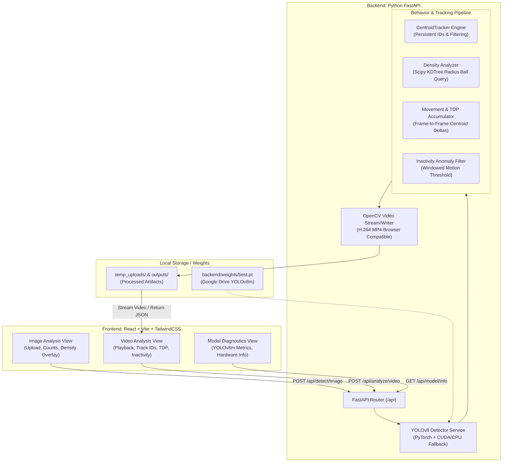

# Technical Integration Audit: AI-Based Poultry Detection and Behaviour Analysis System

**Date:** November 2, 2026  
**Project A (User Google Drive):** YOLOv8 Chicken Detector (`best.pt` at `/content/drive/MyDrive/PoultryDetection/runs/chickendet_yolov8m_baseline/weights/best.pt`)  
**Project B (Local Workspace):** Chicken Behavior Analysis (`TaherehZarratEhsan/Chicken-Behavior-Analysis`)  
**Target Architecture:** FastAPI Backend (Python) + React Frontend (Vite) + OpenCV + YOLOv8 + Reusable Behavior Modules  

---

## 1. Executive Summary

This audit evaluates the feasibility of integrating a pre-trained **YOLOv8** chicken detector (`best.pt`) with the tracking, density estimation, trajectory measurement, and inactivity detection modules from the local **Chicken Behavior Analysis** repository.

### Key Audit Conclusions
1. **Zero Runtime Dependency on YOLOv4:** The tracking (`CentroidTracker`), density detection (`scipy.spatial.KDTree`), distance measurement (Euclidean centroid deltas), and inactivity analysis algorithms in Project B depend exclusively on **bounding box geometry `(xmin, ymin, width, height)` and centroid coordinates `(cx, cy)`**. They have zero functional or structural dependency on YOLOv4 feature maps or Darknet internals.
2. **Missing/Corrupt Model Weights in Project B:** The local repository contains an incomplete TensorFlow SavedModel directory (`final_training/` is missing `variables.data-00000-of-00001` and contains only `variables.index` and `saved_model.pb`). Pretrained Darknet weights (`yolov4.conv.137` / `yolov4.weights`) are completely absent. Therefore, Project B cannot run standalone detection without external weights. Integrating your YOLOv8 model (`best.pt`) completely resolves this deficiency.
3. **Tracking Architecture:** Project B vendors a multi-object tracking library (`adipandas/multi-object-tracker`) implementing a greedy `CentroidTracker` with distance gating. Detections from YOLOv8 can be fed directly into this tracker with a trivial adapter (converting PyTorch tensor boxes to NumPy `xywh`).
4. **Behavior Analysis Nature:** "Sick Detection" in this repository is strictly a **heuristic temporal inactivity / low-mobility detector** (accumulated centroid displacement $\le 5$ pixels across a 250-frame window). It is not an AI diagnostic model or medical classifier. In the integrated system, this must be surfaced as an **Inactivity / Low-Mobility Indicator**.
5. **Hardware Readiness:** The local system is equipped with an **NVIDIA GeForce RTX 3050 Laptop GPU (6GB VRAM, CUDA 13.0 driver)**, enabling real-time local GPU inference for YOLOv8m with seamless CPU fallback.

---

## 2. Project Structure & Asset Inventory

### 2.1 File & Directory Breakdown

| Directory / File | Description | Inventory & Status |
| :--- | :--- | :--- |
| `Annotation/` | Text annotation files in YOLO format (`anno3.txt`, `anno4.txt`). | `anno3.txt` (60.4 KB, 20 image annotations), `anno4.txt` (758 B). Training artifacts, not needed for inference. |
| `Classes/` | Class label files. | `classes.txt` contains `0` (chicken); `classes_gathering.txt` contains `1`. |
| `darknet/` | Full C-based Darknet source code, Makefiles, and configs (`yolov4.cfg`). | Linux/Colab C build. Contains **no weights**. Obsolete for our YOLOv8 Python stack. |
| `final_training/` | Exported TensorFlow 2 SavedModel directory. | **Incomplete:** `saved_model.pb` (5.77 MB), `keras_metadata.pb` (898 KB), `variables/variables.index` (34.7 KB). **Missing `variables.data*` file.** Unusable. |
| `img/` | Raw training image dataset (20 images). | 20 PNG frames (`frame00001.png` to `frame07101.png`). Useful as local test samples. |
| `img_test/` | Raw evaluation image dataset (28 images). | 28 PNG frames (`frame00097.png` to `frame04101.png`). Excellent benchmark set for image detection and density analysis. |
| `multi-object-tracker/` | Vendored third-party tracking package (`motrackers` by Aditya M. Deshpande). | Contains `CentroidTracker`, `CentroidKF_Tracker`, `SORT`, `IOUTracker`. Core tracking engine to be reused. |
| `Tracker_Distance_Measure/` | Pre-rendered demonstration videos. | 9 MP4 output videos (33 MB – 86 MB) with green tracking annotations already burned in. Useful for visual reference. |
| `xml/` | Pascal VOC XML annotation files (20 files). | Ground truth bounding boxes for `img/`. Not needed at runtime. |
| `yolo-v4-tf.keras/` | Keras/TF implementation of YOLOv4 (`models.py`, `utils.py`, `loss.py`, etc.). | Used originally to fine-tune YOLOv4. Can be entirely bypassed in favor of `ultralytics`. |
| `*.ipynb` (5 files) | Research and pipeline notebooks. | Detailed in Section 3. |
| `README.md` | Project documentation, competition certificate, and citations. | Apache 2.0 license declaration. |

### 2.2 Model Weights & Configuration Inventory

- **Local Weights:** None functional. `final_training/variables` lacks data shards.
- **External Dependencies Referenced in Code:**
  - `/content/drive/My Drive/Colab Notebooks/darknet/yolov4.conv.137` (missing from repo).
  - `/content/drive/MyDrive/Colab Notebooks/ICCKE2022_Challenge/final_training` (corrupt in repo).
- **Target Weights:** Google Drive YOLOv8m model (`best.pt`).

### 2.3 Licensing & Attribution

- **Project B:** Licensed under the **Apache License 2.0** (`README.md`). Allows commercial and non-commercial reuse and modification with attribution.
  - *Citation requirement:* Tahereh Zarrat Ehsan, Seyed Mehdi Mohtavipour Shafti, arXiv:2401.12176 (ICCKE 2022 Challenge).
- **multi-object-tracker:** Developed by Aditya M. Deshpande (`https://github.com/adipandas/multi-object-tracker`). Retain copyright notice in tracking module headers.
- **YOLOv8 / Ultralytics:** AGPL-3.0 for open-source use. Standard Python API.

---

## 3. Deep-Dive Notebook Analysis

All 5 notebooks consist of a single top-to-bottom monolithic execution cell developed for Google Colab with hardcoded `/content/drive/` mounts.

```
Notebooks in Project B
├── Broiler_Detection.ipynb        -> YOLOv4 TF/Keras Training & Static Inference (Bypass)
├── Broiler_Tracking.ipynb         -> Video Centroid Tracking Pipeline (Reuse Core Tracker)
├── Broiler_Density_Detection.ipynb-> KDTree Spatial Clustering on BBoxes (Reuse Math)
├── Broiler_Distance_Measure.ipynb -> Centroid Trajectory & Total Distance Pixel (Reuse Math)
└── Broiler_Sick_Detection.ipynb    -> Temporal Windowed Low-Mobility Indicator (Reuse Logic)
```

---

### Notebook 1: `Broiler_Detection.ipynb`
1. **Purpose:** Fine-tunes a Keras/TF YOLOv4 model on chicken annotations (`anno3.txt`) and runs static image predictions.
2. **Input Format:** Static images (`.png`).
3. **Model & Weights:** YOLOv4 architecture via `yolo-v4-tf.keras/models.py`. Requires pre-trained weights `yolov4.conv.137` and outputs to `final_training/`.
4. **Dependencies:** `tensorflow`, `numpy`, `pandas`, `matplotlib`, `scikit-learn`, `keras`, `opencv-python`.
5. **Execution Role:** Training (1000 epochs) + Static inference.
6. **Independent Reusability:** **Do Not Reuse.** Your pre-trained YOLOv8 model (`best.pt`) replaces this entirely with higher accuracy, lower latency, and modern PyTorch execution.
7. **Dependencies on Other Files:** `yolo-v4-tf.keras/models.py`, `utils.py`, `config.py`, `Classes/classes.txt`, `Annotation/anno3.txt`.
8. **Outputs:** Matplotlib plotted images with bounding boxes.
9. **Defects & Assumptions:** Hardcoded Colab paths (`/content/drive/My Drive/...`); missing weights file.

---

### Notebook 2: `Broiler_Tracking.ipynb`
1. **Purpose:** Tracks chickens frame-by-frame across video, assigns persistent IDs, plots centroids, and writes an annotated video.
2. **Input Format:** Video (`.mp4`, resized to $480 \times 480$).
3. **Model & Weights:** YOLOv4 loaded from `final_training`.
4. **Dependencies:** `opencv-python`, `numpy`, `matplotlib`, `motrackers` (`scipy`).
5. **Execution Role:** Frame-by-frame inference + Object tracking + Video export.
6. **Independent Reusability:** **High Reusability.** The tracking orchestration is completely modular.
7. **Tracking Algorithm & Mechanics:**
   - Tracker: `CentroidTracker(max_lost=5, tracker_output_format='mot_challenge')`.
   - Input to tracker: `bb_xywh` $[x_{min}, y_{min}, w, h]$, confidence score, class ID.
   - Tracker computes centroids and matches them across consecutive frames using Euclidean distance matrix minimization (`scipy.spatial.distance.cdist`).
   - If an object is missing for $> 5$ frames (`max_lost=5`), its track is deregistered.
   - Output tuple per active track: `(frame_id, track_id, xmin, ymin, width, height, conf, x, y, z)`.
   - Centroid calculated as:
     $$x_c = x_{min} + 0.5 \cdot w, \quad y_c = y_{min} + 0.5 \cdot h$$
8. **Outputs:** `Tracking_Result.avi` ($480 \times 480$ @ 25 fps).
9. **Defects & Assumptions:**
   - Uses `cv2_imshow` (Google Colab proprietary utility).
   - Hardcoded input path `/video_test/2.mp4` (not included in repo).
   - Video writer uses codec `0` (`cv2.VideoWriter('Tracking_Result.avi', 0, 25, (480, 480))`), creating uncompressed, non-browser-compatible AVI files.

---

### Notebook 3: `Broiler_Density_Detection.ipynb`
1. **Purpose:** Detects localized crowding / abnormal gathering behavior on static images or video frames.
2. **Input Format:** Static image or individual video frame.
3. **Model & Weights:** YOLOv4 (`final_training`).
4. **Dependencies:** `scipy.spatial.KDTree`, `numpy`, `opencv-python`, `pandas`.
5. **Execution Role:** Spatial clustering post-processor.
6. **Independent Reusability:** **High Reusability.** The algorithm is 100% neural-network-agnostic.
7. **Mathematical Mechanics:**
   - Extracts bounding coordinates $P_i = (x_i, y_i)$.
   - Constructs a 2D spatial tree: $\mathcal{T} = \text{KDTree}(\{P_1, P_2, \dots, P_N\})$.
   - Performs a fixed-radius ball query:
     $$N_r(P_i) = \{ P_j \in \mathcal{T} \mid \|P_i - P_j\|_2 \le R \}, \quad \text{where } R = 100 \text{ pixels}$$
   - Local Density: $D_i = |N_r(P_i)|$.
   - High-Density Condition:
     $$\text{HighDense}(P_i) \iff D_i \ge 6$$
   - Chickens meeting the criterion are highlighted with orange/red bounding boxes (`(0, 145, 255)`) and labeled `"High Dense"`.
8. **Defects & Code Flaws:**
   - **Coordinate Bias:** The notebook code feeds top-left corners `points = bb_xy` into `KDTree` instead of centroids $(x_c, y_c)$. This introduces spatial distortion when chickens have varying aspect ratios. In our adapter, we fix this by using true centroids.
   - **Resolution Hardcoding:** $R = 100\text{ px}$ assumes a $480 \times 480$ image. On a $1920 \times 1080$ frame, 100 px is much smaller physically. Radius must be normalized to relative frame dimensions.

---

### Notebook 4: `Broiler_Distance_Measure.ipynb`
1. **Purpose:** Measures individual chicken physical activity by accumulating movement distance over video frames.
2. **Input Format:** Video (`.mp4`, 300 frames @ 25 fps).
3. **Model & Weights:** YOLOv4 (`final_training`).
4. **Dependencies:** `motrackers.CentroidTracker`, `numpy`, `opencv-python`.
5. **Execution Role:** Video tracking + Trajectory integration.
6. **Independent Reusability:** **High Reusability.**
7. **Mathematical Mechanics:**
   - Tracks maintain a state array `my_tracks` with columns:
     - Index 1: `track_id`
     - Index 7: Cumulative Total Distance in Pixels (`TDP`)
     - Index 8: Current Centroid $x_c$
     - Index 9: Current Centroid $y_c$
   - For each tracked ID present in both current and previous frames:
     $$\Delta d = \sqrt{(x_c^{(t)} - x_c^{(t-1)})^2 + (y_c^{(t)} - y_c^{(t-1)})^2}$$
   - **Teleportation / Noise Filter:**
     $$\Delta d = 0 \quad \text{if } \Delta d > 30\text{ pixels}$$
     *(Prevents false distance accumulation when tracker re-associates or jumps).*
   - **Cumulative Distance:**
     $$\text{TDP}^{(t)} = \text{TDP}^{(t-1)} + \Delta d$$
   - Displays label `TDP = <val>` above each chicken's bounding box.
8. **Defects & Limitations:**
   - Distances are in image pixels (`px`), not real-world units (meters).
   - Incomplete state management when tracks disappear and reappear.

---

### Notebook 5: `Broiler_Sick_Detection.ipynb`
1. **Purpose:** Flags chickens showing prolonged lack of movement over a temporal window as potentially inactive or lethargic.
2. **Input Format:** Video (`.mp4`, 1500 frames @ 25 fps).
3. **Model & Weights:** YOLOv4 (`final_training`).
4. **Dependencies:** `motrackers.CentroidTracker`, `numpy`, `opencv-python`.
5. **Execution Role:** Temporal windowed anomaly filter.
6. **Independent Reusability:** **High Reusability (with bug-fixes).**
7. **Mathematical Mechanics:**
   - Tracks movement using the same TDP accumulator as Notebook 4.
   - **Sliding Window Evaluation:** Every $W = 250$ frames ($\approx 10$ seconds at 25 fps):
     $$\text{Inactive}(i) \iff 0 < \text{TDP}_i \le 5\text{ pixels}$$
   - Chickens with $\text{TDP} \le 5\text{ px}$ across the 250-frame window are rendered in bright RED `(0, 0, 255)`.
   - The TDP accumulator for the window is reset: $\text{TDP}_i \leftarrow 0$.
8. **Critical Bug in Notebook Code:**
   - In the notebook, `my_tracks[index, 7] = 0` is located inside the track iteration loop. If a track appears for the first time on frame 250, `index` is unbound, raising an `UnboundLocalError`.
   - The accumulator is reset only at exact multiples of 250, ignoring tracks that appeared midway through the window.
9. **Clinical / Scientific Reality:**
   - This logic is purely a **visual motion stillness detector**.
   - It cannot distinguish sleeping/resting broilers from diseased broilers.
   - **Terminology Rule:** Must be presented as **"Inactivity / Low-Mobility Indicator"**, not as a medical or veterinary diagnosis.

---

## 4. Model Compatibility & Adapter Design

### 4.1 Compatibility Assessment

| Dimension | YOLOv4 (Repo Implementation) | YOLOv8 (Your Project A `best.pt`) | Compatibility Status |
| :--- | :--- | :--- | :--- |
| **Framework** | TensorFlow 2.x / Darknet C | PyTorch / Ultralytics | Independent frameworks; bridge via NumPy |
| **Input Shape** | Fixed $416 \times 416 \times 3$ or $480 \times 480 \times 3$ | Dynamic ($640 \times 640$ default, handles any aspect ratio) | YOLOv8 handles arbitrary resolutions natively |
| **Output Format** | Pandas DataFrame `[x1, y1, x2, y2, class, score, w, h]` | PyTorch `Boxes` object (`xyxy`, `xywh`, `conf`, `cls`) | **100% Compatible via 4-line adapter** |
| **Tracker Requirement** | Array of `[xmin, ymin, width, height]`, `conf`, `class_id` | Readily extracted from `results[0].boxes.xywh` | **Directly Compatible** |
| **Density Requirement** | Coordinates array $(x_i, y_i)$ | Centroids $(x_c, y_c)$ directly extracted from boxes | **Directly Compatible** |
| **Hardware** | Custom TF operations | Torch CUDA / Torch CPU | RTX 3050 supported natively |

### 4.2 The Unified Detection-to-Behavior Adapter

No modifications to YOLOv8 model weights or training are needed. A single clean Python adapter extracts the exact inputs expected by `CentroidTracker` and `KDTree`:

```python
# Adapter Pattern: YOLOv8 to Behavior Analysis Pipeline
from ultralytics import YOLO
import numpy as np

class ChickenDetector:
    def __init__(self, weights_path: str, device: str = "auto"):
        self.model = YOLO(weights_path)
        self.device = device

    def detect(self, frame: np.ndarray, conf_thresh: float = 0.25):
        """
        Runs YOLOv8 and formats output for Tracker & Density Analysis.
        Returns:
            bboxes_xywh: np.ndarray [[xmin, ymin, w, h], ...]
            scores: np.ndarray [conf1, conf2, ...]
            class_ids: np.ndarray [0, 0, ...]
            centroids: np.ndarray [[cx, cy], ...]
        """
        results = self.model.predict(frame, conf=conf_thresh, device=self.device, verbose=False)[0]
        
        if len(results.boxes) == 0:
            return np.empty((0, 4)), np.empty((0,)), np.empty((0,), dtype=int), np.empty((0, 2))
            
        boxes = results.boxes
        xyxy = boxes.xyxy.cpu().numpy()
        scores = boxes.conf.cpu().numpy()
        class_ids = boxes.cls.cpu().numpy().astype(int)
        
        # Convert xyxy [x1, y1, x2, y2] to xywh [xmin, ymin, width, height]
        xmin = xyxy[:, 0]
        ymin = xyxy[:, 1]
        width = xyxy[:, 2] - xyxy[:, 0]
        height = xyxy[:, 3] - xyxy[:, 1]
        bboxes_xywh = np.stack([xmin, ymin, width, height], axis=1)
        
        # Exact centroids
        centroids = np.stack([xmin + 0.5 * width, ymin + 0.5 * height], axis=1)
        
        return bboxes_xywh, scores, class_ids, centroids
```

---

## 5. Exact Files Required from Google Drive

To build and run the integrated application locally, you only need to download **two small files** from your Google Drive:

### 5.1 Mandatory File

| File on Google Drive | Local Destination | Size | Purpose |
| :--- | :--- | :--- | :--- |
| `/content/drive/MyDrive/PoultryDetection/runs/chickendet_yolov8m_baseline/weights/best.pt` | `<project_root>/backend/weights/best.pt` | $\approx 50$ MB | Pre-trained YOLOv8m weights for all chicken detection and tracking. |

### 5.2 Optional Metric/Diagnostic File (Nice-to-Have)

| File on Google Drive | Local Destination | Size | Purpose |
| :--- | :--- | :--- | :--- |
| `/content/drive/MyDrive/PoultryDetection/runs/chickendet_yolov8m_baseline/results.csv` *(or `args.yaml`)* | `<project_root>/backend/weights/results.csv` | $< 50$ KB | Used to render model training metrics (mAP@0.5, Precision, Recall, Loss curves) in the frontend dashboard. |

### 5.3 Files You MUST NOT Download
- **DO NOT** download `/content/chickendet_yolo` (the training dataset is not needed for inference).
- **DO NOT** download `last.pt`, `epoch*.pt`, or other intermediate checkpoints.
- **DO NOT** download raw Colab logs, caches, or virtual environment files.

---

## 6. Recommended Final Application Architecture

### 6.1 System Architecture Diagram



### 6.2 Feature Classification: Implemented vs. Proposed

| Feature | Status in Project B | Proposed Integration Implementation |
| :--- | :--- | :--- |
| **Chicken Bounding Box Detection** | Implemented via YOLOv4 | **Upgraded:** Powered by your YOLOv8m `best.pt`. |
| **Chicken Count** | Implemented | **Implemented:** Direct sum of detected bounding boxes. |
| **Crowding / Gathering Density** | Implemented via KDTree ($R=100$) | **Enhanced:** Centroid-based KDTree with configurable radius and count thresholds. |
| **Persistent Multi-Object Tracking** | Implemented via `CentroidTracker` | **Integrated:** Reuses `motrackers.CentroidTracker` driven by YOLOv8 detections. |
| **Movement Distance (TDP)** | Implemented via pixel deltas | **Integrated:** Frame-to-frame Euclidean accumulator with 30 px jump filter. |
| **Inactivity / Anomaly Flagging** | Implemented as 250-frame TDP $\le 5$ px | **Refactored:** Bug-fixed sliding window labeled as **"Inactivity Indicator"**. |
| **Veterinary Disease Diagnosis** | **Not implemented** (does not exist) | **Explicitly Out of Scope:** App will strictly report mobility indicators, not medical diagnoses. |
| **Web UI Dashboard** | Not implemented (Jupyter only) | **Implemented:** Modern React + Vite UI with real-time video playback and charts. |

---

## 7. Technical Risks & Environmental Verification

### 7.1 Local Environment Audit
- **Operating System:** Windows 11 (64-bit).
- **GPU Available:** NVIDIA GeForce RTX 3050 Laptop GPU (6144 MB VRAM, Driver 581.83, CUDA 13.0).
- **Python Version:** Python 3.12.7.
- **Node / Package Manager:** Node.js v24.21.0 and npm 11.19.0 verified working.
- **Current Python Packages:** `numpy` (2.5.4), `opencv-python` (5.0.0.93), `matplotlib` (3.11.2).
- **Missing Required Packages:** `torch`, `torchvision`, `ultralytics`, `fastapi`, `uvicorn`, `scipy`, `pydantic`.

### 7.2 Key Risks & Mitigations

1. **NumPy 2.x Compatibility Risk:**
   - *Risk:* The system currently has `numpy 2.5.4`. Some pre-compiled PyTorch / SciPy wheels on Windows can encounter C-ABI incompatibilities with NumPy 2.x.
   - *Mitigation:* Ensure PyTorch 2.3+ (which natively supports NumPy 2) is installed, or lock dependencies inside a dedicated virtual environment with `numpy<2` if compilation warnings emerge.
2. **Video Codec Web Playback Risk:**
   - *Risk:* OpenCV's default `cv2.VideoWriter` on Windows often generates `XVID` or uncompressed `AVI` formats that **cannot play directly in HTML5 `<video>` tags** in web browsers (Chrome/Edge/Firefox).
   - *Mitigation:* Encode video using `mp4v` or use a lightweight ffmpeg pipe to write standard H.264/AAC MP4 files that stream smoothly in React.
3. **Memory / Latency on Large Videos:**
   - *Risk:* Long videos (e.g., $> 1000$ frames) processed synchronously will cause HTTP request timeouts and heavy memory accumulation if all frames are stored in RAM.
   - *Mitigation:* Process frames as a generator, stream progress via WebSocket or SSE (Server-Sent Events), or save outputs directly to disk and return an artifact stream.
4. **Tracker ID Switching in Crowded Pens:**
   - *Risk:* `CentroidTracker` uses greedy centroid Euclidean distance. In extremely dense clusters where chickens overlap, ID switches can occur.
   - *Mitigation:* Retain the 30-pixel jump filter implemented in Project B to prevent spurious TDP inflation during ID reassignments.

---

## 8. Concrete Implementation Plan

### 8.1 Proposed Directory Structure

```
Chicken-Behavior-Analysis-main/
├── backend/
│   ├── app/
│   │   ├── api/
│   │   │   ├── __init__.py
│   │   │   ├── routes_image.py     # Single image detection & density endpoints
│   │   │   ├── routes_video.py     # Video tracking & behavioral analysis endpoints
│   │   │   └── routes_model.py     # Model metadata & performance metrics
│   │   ├── core/
│   │   │   ├── detector.py         # YOLOv8 wrapper (Ultralytics)
│   │   │   ├── tracker.py          # CentroidTracker adapter (from motrackers)
│   │   │   ├── density.py          # KDTree spatial clustering
│   │   │   ├── distance.py         # Centroid deltas & TDP accumulator
│   │   │   └── inactivity.py       # Windowed mobility anomaly analyzer
│   │   └── main.py                 # FastAPI application factory & CORS setup
│   ├── weights/
│   │   └── best.pt                 # <--- Download from Google Drive
│   ├── requirements.txt            # Backend Python dependencies
│   └── run.py                      # Uvicorn entry point
├── frontend/                       # React + Vite web dashboard
│   ├── src/
│   │   ├── components/
│   │   │   ├── ImageAnalyzer.jsx   # Upload & annotated canvas
│   │   │   ├── VideoAnalyzer.jsx   # Video player & behavioral metrics
│   │   │   ├── MetricsCard.jsx     # Poultry count, dense count, inactive count
│   │   │   └── ModelStats.jsx      # Diagnostic display
│   │   ├── App.jsx
│   │   └── main.jsx
│   ├── package.json
│   └── vite.config.js
├── multi-object-tracker/           # Preserved original tracking library
├── img_test/                       # Preserved test images for verification
├── Tracker_Distance_Measure/       # Preserved demonstration assets
└── INTEGRATION_AUDIT.md            # This report
```

### 8.2 Recommended API Endpoints

| Method | Endpoint | Description | Request Body | Response Payload |
| :--- | :--- | :--- | :--- | :--- |
| `GET` | `/api/health` | Service and GPU status | None | `{"status": "ok", "device": "cuda:0", "gpu": "RTX 3050"}` |
| `GET` | `/api/model/info` | YOLOv8 model architecture & classes | None | `{"model": "yolov8m", "classes": ["chicken"], "weights": "best.pt"}` |
| `POST` | `/api/detect/image` | Image detection & density calculation | Multipart `file`, `conf`, `density_radius`, `density_threshold` | Annotated image (Base64/URL), `chicken_count`, `high_density_clusters`, detections array |
| `POST` | `/api/analyze/video` | Full video tracking & behavior analysis | Multipart `file`, `conf`, `inactivity_window`, `inactivity_thresh` | Video URL, summary stats (`total_tracked`, `avg_tdp`, `inactive_count`), time-series log |

### 8.3 Prioritized Step-by-Step Implementation Sequence

1. **Step 1: Download Weights:**
   - Copy `best.pt` from Google Drive into `backend/weights/best.pt`.
2. **Step 2: Backend Core Engine:**
   - Implement `ChickenDetector` wrapping `ultralytics.YOLO`.
   - Wrap `CentroidTracker` from `multi-object-tracker/motrackers/tracker.py`.
   - Implement `DensityAnalyzer` (KDTree) and `BehaviorAnalyzer` (TDP + Inactivity window).
3. **Step 3: Verification Script:**
   - Run a standalone Python test script against `img_test/frame00097.png` and a short video clip to verify detection, tracking, density, and inactivity output without starting the web server.
4. **Step 4: FastAPI Service:**
   - Expose endpoints for `/api/detect/image` and `/api/analyze/video`.
5. **Step 5: React Dashboard:**
   - Create interactive UI with image upload/annotation viewer, video player, and real-time behavioral metrics cards.
6. **Step 6: End-to-End Test & Deliver:**
   - Validate full flow on local images and video.

---

## 9. Immediate Next Action for the User

To proceed with implementation, **please perform the following action:**

> **Download your trained weights file `best.pt` from Google Drive:**  
> **Source:** `/content/drive/MyDrive/PoultryDetection/runs/chickendet_yolov8m_baseline/weights/best.pt`  
> **Destination:** Save it into the project folder at:  
> `Chicken-Behavior-Analysis-main\best.pt` *(or we will place it into `backend/weights/best.pt` during setup).*

*(Optional)* If you would like the dashboard to display your training evaluation graphs and mAP metrics, also download `results.csv` from the same training run directory.

Once you have downloaded `best.pt` or placed it in the project folder, let me know, and we will begin building the unified backend and frontend application.

