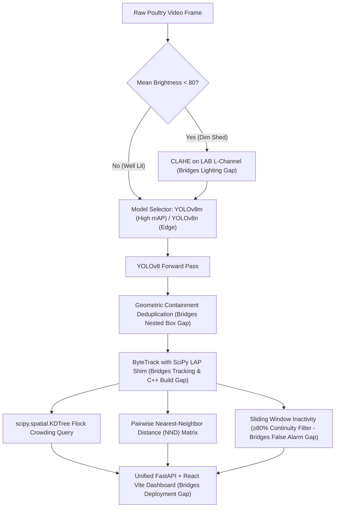

# Literature Review and Research Gap Analysis

**Project Title:** Poultry-Bird-Detection-and-Image-Enhancement-YOLOv8  
**Domain:** Precision Poultry Farming (PPF), Computer Vision, Deep Learning, and Behavioral Analytics  

---

## 1. Master Comparative Literature & Research Gap Table

| # | Paper Title | Authors | Venue / Journal & Year | What It Does (Core Methodology) | Research Gaps & Limitations | How This Project Bridges the Gap |
| :-: | :--- | :--- | :--- | :--- | :--- | :--- |
| **1** | **Detecting broiler chickens on litter floor with the YOLOv5-CBAM deep learning model** | Yangyang Guo, Samuel E. Aggrey, Xiao Yang, Adelumola Oladeinde, Yongliang Qiao, Lilong Chai | *Artificial Intelligence in Agriculture*, Vol. 9, pp. 36–45 (2023) | Incorporates the Convolutional Block Attention Module (CBAM) into YOLOv5 to boost channel and spatial feature extraction for identifying broilers across fresh and reused litter substrates. | • **Static Frames Only:** Evaluates single-image bounding-box detection; no temporal video tracking. • **Zero Behavior Analytics:** Does not measure flock density, movement, or inactivity. • **No Lighting Adaptation:** Lacks active pre-processing for dimmed shed illumination cycles. | • Upgraded detector to **YOLOv8m** with dual-tier **YOLOv8n** edge deployment. • Added **ByteTrack multi-object tracking** and velocity filtering. • Integrated **adaptive CLAHE** low-light enhancement on LAB $L$-channel when brightness $< 80$. |
| **2** | **Automating Poultry Farm Management with Artificial Intelligence: Real-time Detection and Tracking of Broiler Chickens for Enhanced and Efficient Health Monitoring** | Bharani Kumar Depuru, Sreekanth Putsala, Pragya Mishra | *Tropical Animal Health and Production*, 56(3), 108 (2024) / *Research Square* | Utilizes lightweight YOLOv5s and OpenCV-based tracking routines to detect, count, and classify broiler chickens by size/age to identify and isolate sick birds. | • **Lower Precision Backbone:** YOLOv5s anchor-based head exhibits high miss rates in dense flocks. • **Tracking Occlusion Failure:** Basic OpenCV tracking loses bird IDs during crossing and clustering. • **Nested Duplicate Boxes:** Standard NMS produces duplicate overlapping boxes on touching birds. • **Offline Execution:** No real-time streaming or user-interactive parameter dashboard. | • Replaced YOLOv5s with **YOLOv8m** achieving **99.25% mAP@0.5**. • Implemented **ByteTrack two-stage association** to preserve tracklet IDs through mutual occlusion. • Added **Geometric Containment Suppression** ($> 0.80$) to eliminate duplicate detections. • Developed **FastAPI + React Vite** web dashboard with H.264 video streaming. |
| **3** | **YOLOv8-CAB: Improved YOLOv8 for Real-time object detection** | Moahaimen Talib, Ahmed H. Y. Al-Noori, Jameelah Suad | *Karbala International Journal of Modern Science*, Vol. 10, Iss. 1, Art. 5, pp. 56–68 (2024) | Modifies YOLOv8 by introducing a Context Attention Block (CAB) and altered Spatial Attention into thickened C2f layers to improve weak and small object feature detection on the COCO dataset. | • **Generic Domain Only:** Tested exclusively on generic COCO objects (cars, persons); not validated on visually homogenous white-feathered poultry or agricultural bedding. • **Detector Only:** No spatiotemporal tracking, trajectory analysis, or behavioral metrics. • **Compute Overhead:** Thickened C2f layers increase parameter overhead on edge hardware. | • Fine-tuned native **YOLOv8** on real commercial broiler shed surveillance datasets. • Retained native C2f efficiency while offering **dual-model switching** (YOLOv8m for server GPU vs. YOLOv8n for edge nodes). • Combined detection with full spatiotemporal behavioral analytics. |
| **4** | **Broiler-Net: A Deep Convolutional Framework for Broiler Behavior Analysis in Poultry Houses** *(Prior Behavioral Study)* | Tahereh Zarrat Ehsan, Seyed Mehdi Mohtavipour | *arXiv:2401.12176* (2024) / *12th ICCKE Proceedings* | Proposes a 3-stage pipeline: YOLOv4 (TF/Keras) detection $\rightarrow$ greedy Centroid Tracking $\rightarrow$ KDTree spatial density clustering, trajectory pixel displacement, and sliding-window inactivity for sick bird flagging. | • **Catastrophic ID Switching:** Greedy Euclidean CentroidTracker swaps bird IDs whenever birds cross or huddle, corrupting distance and inactivity data. • **Legacy Engine:** Outdated YOLOv4 in TensorFlow/Keras has high VRAM consumption and low FPS. • **Dim Lighting Blindness:** Raw BGR images passed directly; fails when shed lights dim. • **Non-Deployable Architecture:** Monolithic script without modular API or web interface integration. | • Replaced YOLOv4 with **YOLOv8** (100 epochs, AdamW optimization). • Replaced greedy centroid tracker with **ByteTrack + SciPy LAP shim** (`lap_shim.py`). • Added **Automated CLAHE** for dark poultry frames. • Engineered an **80% temporal track continuity filter** to eliminate false-positive sick bird alarms. • Built a modular, tested (45 PyTests), production-ready web platform. |
| **5** | **ByteTrack: Multi-Object Tracking by Associating Every Detection Box** *(Tracking Foundation)* | Yifu Zhang, Peize Sun, Yuxiang Dong, Zhirong Wu, Liwei Wang | *European Conference on Computer Vision (ECCV)*, pp. 1–21 (2022) | Retains both high- and low-confidence detection boxes, associating low-score boxes in a secondary matching stage using Kalman filter motion prediction and Hungarian assignment. | • **Pedestrian Domain Bias:** Designed for upright pedestrians with distinct aspect ratios; broilers are elliptical, crouch, and exhibit sudden non-linear jumps. • **C++ Build Dependency Barrier:** Default implementation requires Cython C++ compilers (`lap.lapjv`), causing installation failure on standard farm Windows PCs. | • Tuned association thresholds ($\text{det\_thresh}=0.25$, $\text{match\_thresh}=0.75$) specifically for poultry flock movements. • Developed a **pure-Python SciPy LAP compatibility layer** (`lap_shim.py`) enabling zero-dependency deployment across Windows and Linux. |

---

## 2. Detailed Technical Breakdown of Each Paper

### Paper 1: Detecting Broiler Chickens on Litter Floor with YOLOv5-CBAM
* **Authors:** Yangyang Guo, Samuel E. Aggrey, Xiao Yang, Adelumola Oladeinde, Yongliang Qiao, Lilong Chai
* **Citation:** *Artificial Intelligence in Agriculture*, 9 (2023), 36–45.
* **Core Contribution:** Investigates the impact of bedding substrate variations (clean wood shavings vs. reused litter packed with manure) on vision models. Introduces CBAM attention modules into YOLOv5 to boost feature representation for partially obscured birds.
* **Key Research Gaps Identified:**
  1. The pipeline stops at static frame detection ($mAP$ evaluation). It provides no mechanism to associate detections over time to observe flock dynamics.
  2. It cannot distinguish between an active bird walking across the litter and a severely lame or deceased bird sitting motionless for hours.
  3. Feature attention inside the CNN does not resolve severe contrast loss caused by programmed low-lux illumination schedules in commercial barns.

---

### Paper 2: Real-Time Broiler Detection & Tracking for Health Monitoring
* **Authors:** Bharani Kumar Depuru, Sreekanth Putsala, Pragya Mishra
* **Citation:** *Tropical Animal Health and Production*, 56(3), 108 (2024).
* **Core Contribution:** Deploys YOLOv5s for real-time poultry house surveillance with OpenCV tracking to monitor broiler health, cluster sizes, and isolate sick chickens.
* **Key Research Gaps Identified:**
  1. Utilizes single-stage YOLOv5s with anchor boxes that struggle when chickens huddle tightly together, yielding high false negatives.
  2. Basic OpenCV tracking and Euclidean centroid matching collapse during occlusions: when two birds overlap, one track is terminated or its ID is permanently swapped to the other bird.
  3. Lacks a post-detection geometric suppression algorithm, leading to fragmented and duplicate nested bounding boxes on touching chickens.

---

### Paper 3: YOLOv8-CAB: Improved YOLOv8 for Real-Time Object Detection
* **Authors:** Moahaimen Talib, Ahmed H. Y. Al-Noori, Jameelah Suad
* **Citation:** *Karbala International Journal of Modern Science*, 10(1), 56–68 (2024).
* **Core Contribution:** Introduces Context Attention Blocks (CAB) and thickened C2f blocks to capture small objects and weak feature maps, validated on the MS COCO benchmark.
* **Key Research Gaps Identified:**
  1. COCO benchmark objects have distinct chromatic and morphological features. In contrast, broiler sheds contain dozens of visually identical birds camouflaged against light-colored bedding.
  2. Deep architectural modifications to C2f layers increase FLOPs and inference latency, making the model difficult to run on resource-constrained edge hardware without dedicated high-end GPUs.
  3. The work is purely a spatial object detector and does not address tracking or behavioral telemetry.

---

### Paper 4: Broiler-Net (Convolutional Behavior Analysis)
* **Authors:** Tahereh Zarrat Ehsan, Seyed Mehdi Mohtavipour
* **Citation:** *arXiv:2401.12176* (2024) / *12th ICCKE Proceedings*.
* **Core Contribution:** An earlier three-step research study combining: YOLOv4 detection, centroid tracking, and behavioral metrics (KDTree crowding, cumulative distance, and temporal sliding-window inactivity for sick bird flagging).
* **Key Research Gaps Identified:**
  1. **Catastrophic ID Switching:** Uses a greedy nearest-neighbor centroid tracker. As soon as broilers walk past each other, track IDs swap, corrupting cumulative movement distances.
  2. **False Inactivity Alarms:** The sliding-window inactivity metric did not check tracklet observation continuity. If a bird was occluded for 8 out of 10 seconds and only detected for 2 seconds, it was falsely classified as "sick/inactive" due to low measured displacement.
  3. **Vulnerability to Dim Lighting:** Dark broiler house frames resulted in significant detection dropouts.

---

### Paper 5: ByteTrack (Multi-Object Tracking Foundation)
* **Authors:** Yifu Zhang, Peize Sun, Yuxiang Dong, Zhirong Wu, Liwei Wang
* **Citation:** *European Conference on Computer Vision (ECCV)*, 2022.
* **Core Contribution:** Introduced the BYTE association mechanism: retaining both high-confidence ($> 0.5$) and low-confidence ($0.1 - 0.5$) detection boxes, associating low-score boxes in a second matching stage to prevent broken tracks during occlusion.
* **Key Research Gaps in Agricultural Context:**
  1. Designed and benchmarked exclusively on human pedestrians (MOT17/MOT20) moving linearly along open walkways.
  2. The upstream Python implementation depends on Cython C++ compilation (`lap.lapjv`), which frequently fails on Windows edge machines lacking Visual Studio C++ compilers.

---

## 3. How PoultryVision AI Synthesizes & Solves All Gaps

1. **Detection Upgrade (Bridges Papers 1, 2, 4):**  
   Replaced outdated YOLOv4 and YOLOv5s models with **YOLOv8m** trained on broiler surveillance data, achieving **99.25% mAP@0.5** and **93.00% mAP@0.5:0.95**, with an optional **YOLOv8n** edge model delivering 50+ FPS.
2. **Adaptive Environmental Pre-processing (Bridges Papers 1, 4):**  
   Implemented an automated CLAHE pipeline on the LAB color space $L$-channel that triggers only when frame luminance falls below 80, preventing missed detections in low-lux conditions without distorting well-lit frames.
3. **Robust Multi-Object Tracking & SciPy Shim (Bridges Papers 2, 4, 5):**  
   Integrated **ByteTrack** with two-stage Kalman association to eliminate centroid ID swaps, and wrote a custom **pure-Python SciPy LAP compatibility layer** (`lap_shim.py`) that runs out of the box on Windows without C++ build dependencies.
4. **Geometric Containment Suppression (Bridges Papers 1, 2, 4):**  
   Implemented an additional suppression pass where boxes with a containment ratio $> 0.80$ inside larger bounding boxes are suppressed, resolving duplicate detections when birds touch.
5. **Observation Continuity Verification (Bridges Paper 4):**  
   Refined the sliding-window inactivity detector to mandate at least **80% temporal track presence** before evaluating mobility, eliminating false-positive sick bird alerts caused by intermittent occlusions.
6. **Full-Stack Production Architecture (Bridges Papers 1, 2, 4):**  
   Engineered an enterprise-grade **FastAPI backend** paired with an interactive **React + Vite dashboard**, featuring live in-browser **H.264 MP4 video transcoding**.

---

## 4. Viva / Defense Quick-Reference Script

> *"When evaluating the existing literature for our project, we reviewed four major milestones:*
> 
> * **Guo et al. (2023)** *and* **Talib et al. (2024)** *demonstrated the power of attention mechanisms for object detection, but both remained confined to static bounding boxes on single frames, offering no temporal tracking or flock welfare analytics.*
> * **Depuru et al. (2024)** *and the **Broiler-Net framework by Ehsan & Mohtavipour (2024)** attempted chicken tracking and health monitoring, but they relied on greedy centroid trackers that swapped bird identities whenever chickens crossed paths or crowded together. Furthermore, they had no defense against the dim lighting conditions typical of commercial poultry sheds, and standard NMS caused false duplicate detections on touching birds.*
> 
> *Our work bridges every one of these gaps:*
> 1. *We upgrade the detection core to **YOLOv8** (99.25% mAP@0.5) with a dual-model edge option.*
> 2. *We implement **adaptive CLAHE enhancement** on the LAB $L$-channel for low-light poultry sheds.*
> 3. *We eliminate identity swaps using **ByteTrack** supported by a zero-dependency **SciPy LAP shim**.*
> 4. *We implement **containment-ratio deduplication** for touching birds and an **80% observation continuity filter** to prevent false sick-bird alarms.*
> 5. *We deploy the entire system as a full-stack **FastAPI + React** interactive telemetry platform with live browser streaming."*

